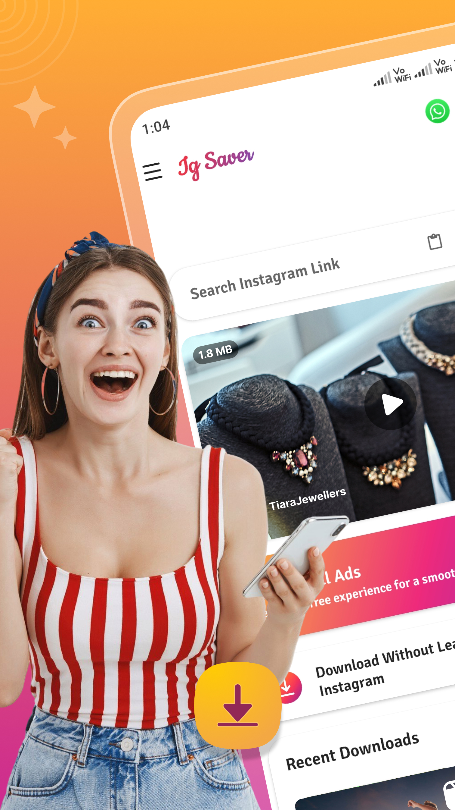
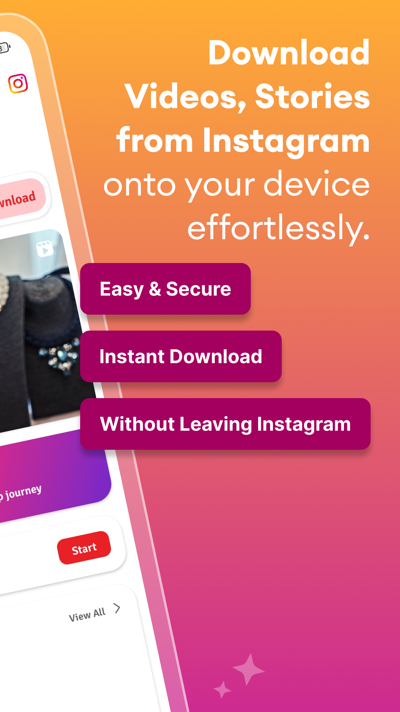
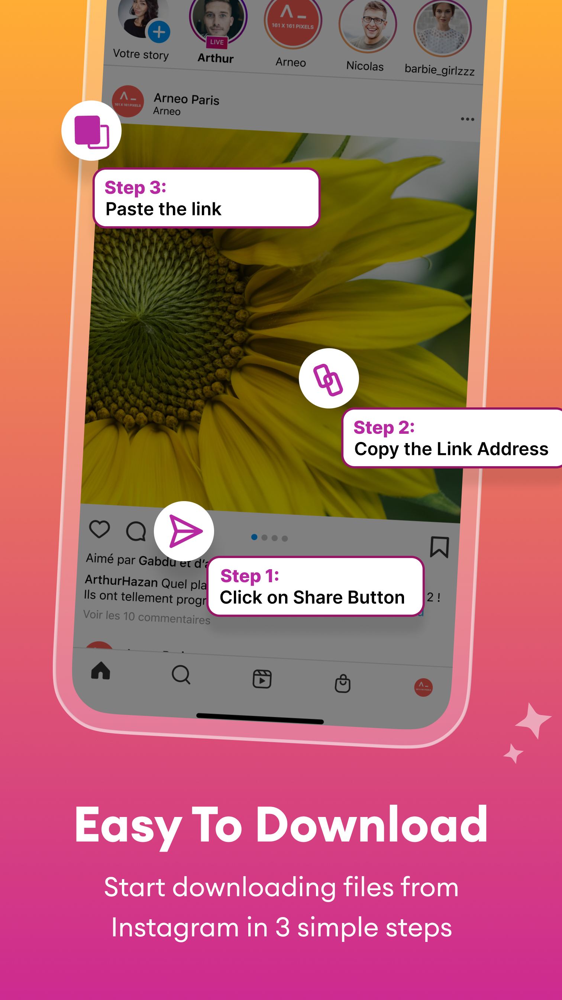
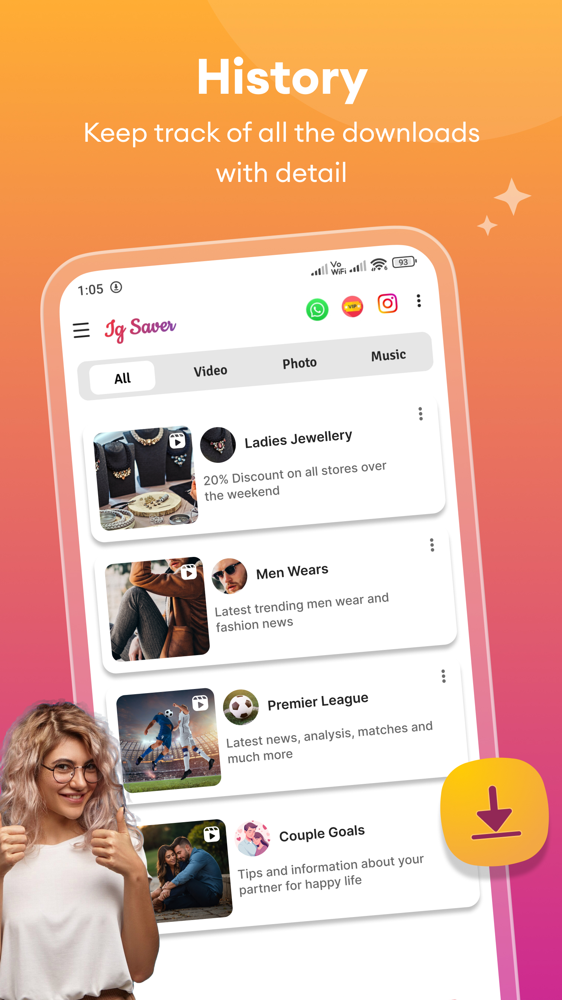
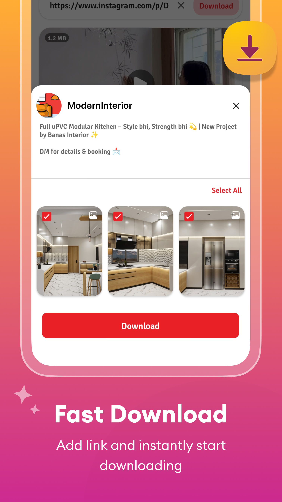
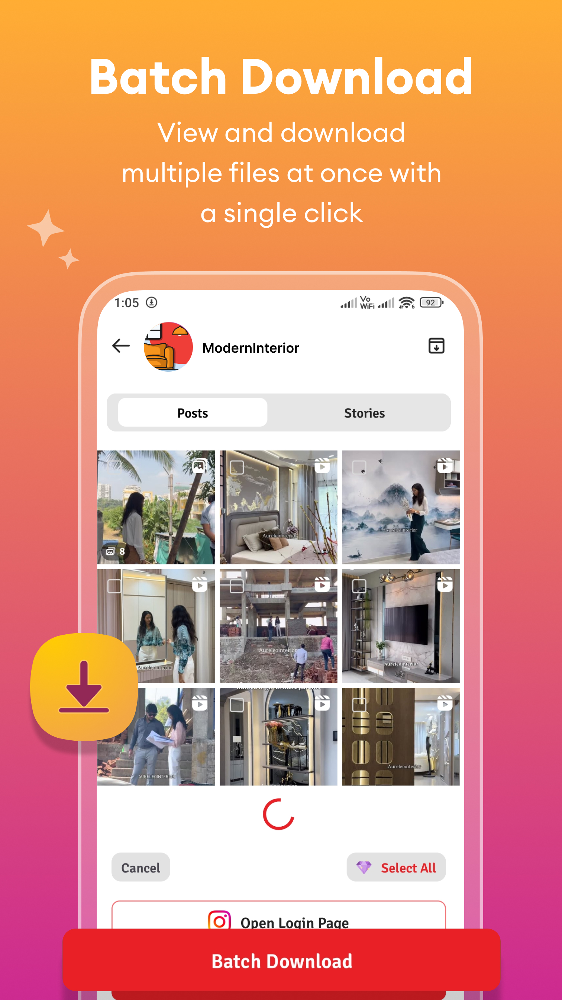
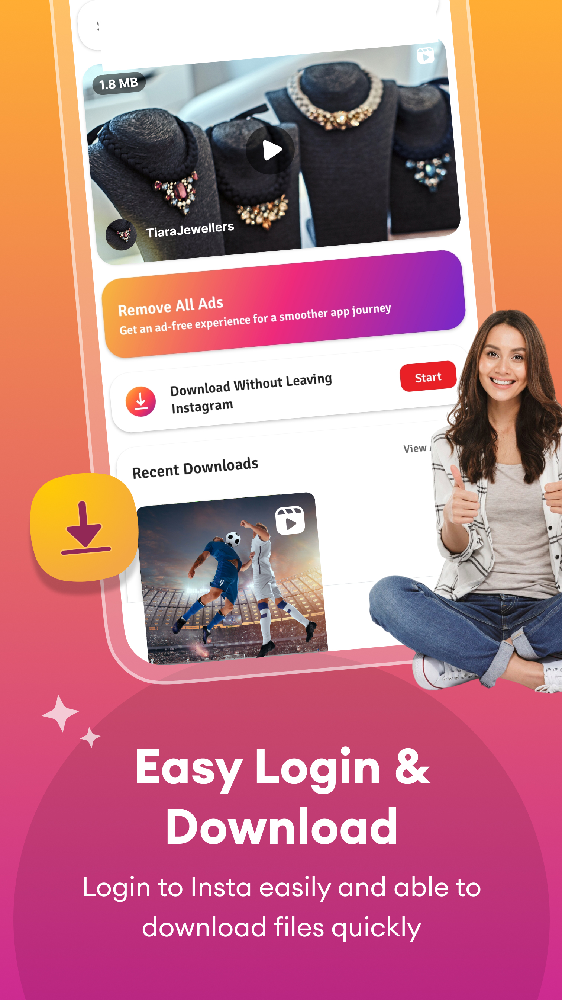
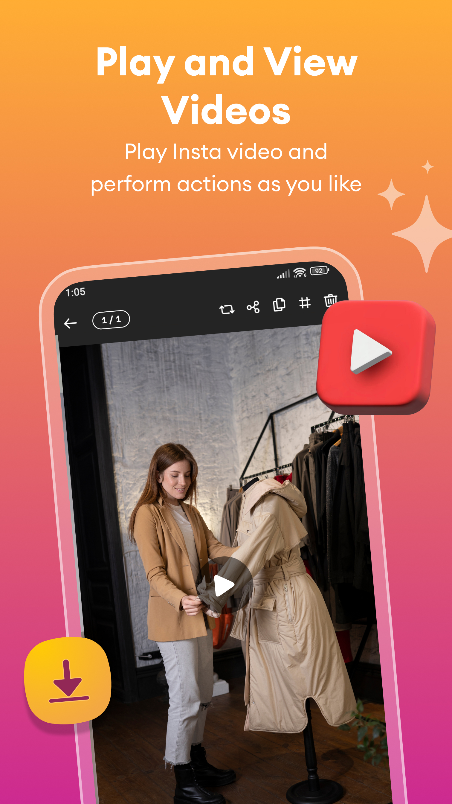

<h1 align="center">Instagram Downloader – Reels, Videos, Photos & Story Saver</h1>
<h3 align="center">This App helps you save Video, Photo, Stories, reels and Highlight from Instagram</h3>
<h4 align="center">A powerful Instagram Downloader to save Reels, Videos, Photos, Stories, and other IG media directly to your device. </h4>

Save your favourite Instagram content and access it anytime, even offline. This Android application provides a simple and convenient way to download Instagram videos, photos, reels, and stories with an easy-to-use interface.

Whether you need an **Instagram Reels Downloader**, **Instagram Story Saver**, or **Video Downloader for Instagram**, this project brings essential downloading features together in one application.

---

## About Instagram Downloader

Instagram Downloader is an Android application designed to help users save publicly accessible Instagram media to their devices.

The application supports multiple types of Instagram content, including:

- Instagram Reels
- Instagram Videos
- Instagram Photos
- Instagram Stories
- Instagram Posts
- Multiple media items from supported posts

Users can download content using supported link-sharing and URL-based workflows and manage their saved media directly inside the application.

## Features

- **Instagram Video Downloader** – Download supported Instagram videos to your device.
- **Instagram Reels Downloader** – Save your favourite Instagram Reels for offline viewing.
- **Instagram Story Saver** – Download supported Instagram stories.
- **Instagram Photo Downloader** – Save Instagram photos and images directly to your gallery.
- **Multiple Media Download** – Download multiple supported media items.
- **Batch Download** – Save multiple media files conveniently.
- **IGTV Video Downloader** - IGTV video downloader.
- **Extract Audio from Video** - Extract audio from the video directly from the app.
- **Set Live Wallpaper** - Set live wallpaper of your downloaded video from the app.
- **Download without Leaving Instagram** - Download photos and videos without leaving Instagram on the fly.
- **Built-in Video Player** – Watch downloaded videos without leaving the application.
- **Image Viewer** – View saved Instagram photos inside the app.
- **Download History** – Access your previously downloaded media.
- **Folders & Organization** – Organize downloaded photos and videos.
- **Favorites** – Keep frequently accessed media in one place.
- **Quick Sharing** – Share downloaded videos and photos with other applications.
- **Simple User Interface** – Clean and intuitive experience.
- **Dark & Light Theme** – Choose your preferred appearance.

## How to Use

1. Open Instagram and find the Reel, video, photo, or story you want to save.
2. Copy the supported Instagram media link or use the Share option.
3. Open Instagram Downloader.
4. Paste or share the link into the application.
5. Start downloading and access the saved media from your downloads.

## Supported Instagram Media

| Media Type | Support |
|---|---|
| Instagram Reels | Supported |
| Instagram Videos | Supported |
| Instagram Photos | Supported |
| Instagram Stories | Supported |
| Instagram Posts | Supported |
| Multiple Media Posts | Supported where available |

*Availability depends on the content type, accessibility, and Instagram platform restrictions.*

## Screenshots

 
 
 
 
 
 
 
 

<!--

  
  
  

-->

## Tech Stack

- **Language:** Kotlin
- **Platform:** Android
- **Architecture:** Android application architecture
- **Analytics & Stability:** Firebase Analytics, Firebase Crashlytics
- **Monetization:** Google AdMob, In-App Purchases
- **Background Processing:** Android background task APIs

## Project Goals

This project aims to provide a practical Android solution for downloading and managing Instagram media.

The focus is on:

- A smooth and intuitive downloading experience.
- Reliable media extraction and download handling.
- Organized offline media management.
- Maintainable Android application architecture.
- Performance and application stability.

## Disclaimer

This project is an independent Android application and is not affiliated with, endorsed by, sponsored by, or officially associated with Instagram or Meta.

Instagram is a trademark of Meta Platforms, Inc.

Users are responsible for ensuring they have the necessary rights and permissions before downloading, saving, sharing, or reusing any content. Please respect content creators' intellectual property and Instagram's terms and policies.

---

## GitHub Topics

`download-instagram-stories` · `insta-reel-downloader` · `instagram` · `instagram-downloader` · `instagram-downloader-source-code` · `instagram-reels-download` · `instagram-story-saver-app` · `instagram-story-video-download` · `instagram-video-download-app` · `instagram-video-downloader` · `instagramdownloader` · `reel` · `reels` · `reels-downloader` · `reels-instagram-download` · `reels-video-downloader` · `story-downloader-source-code` · `video-downloader-for-instagram` · `video-downloader-story-saver`

---

**Built by AndroidCraft Labs**

*Code Ideas. Craft Impact.*
